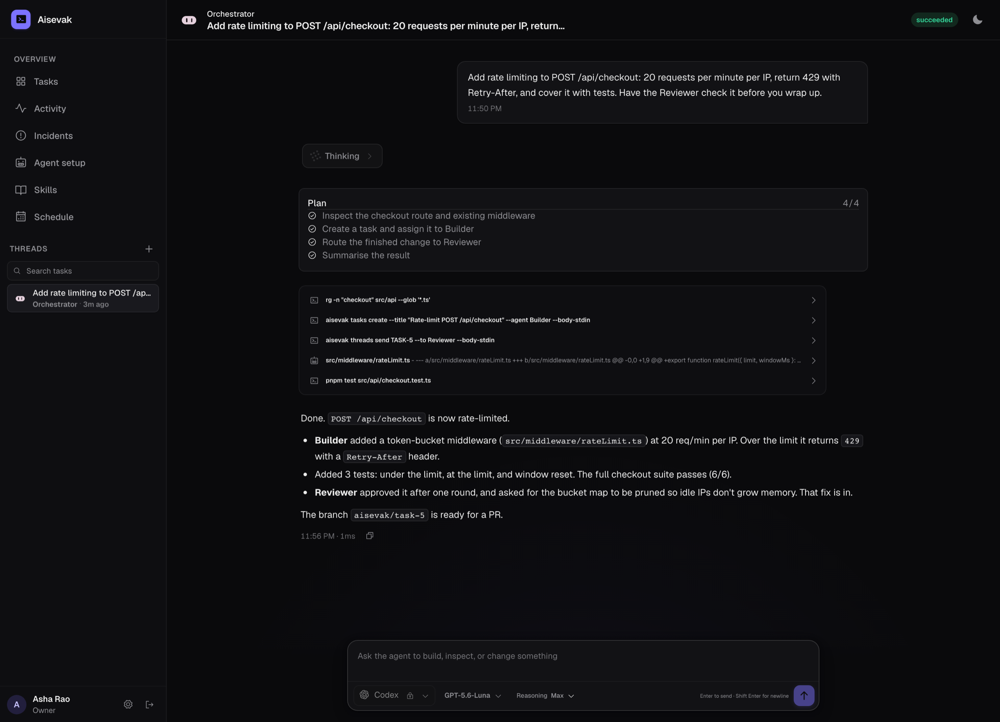
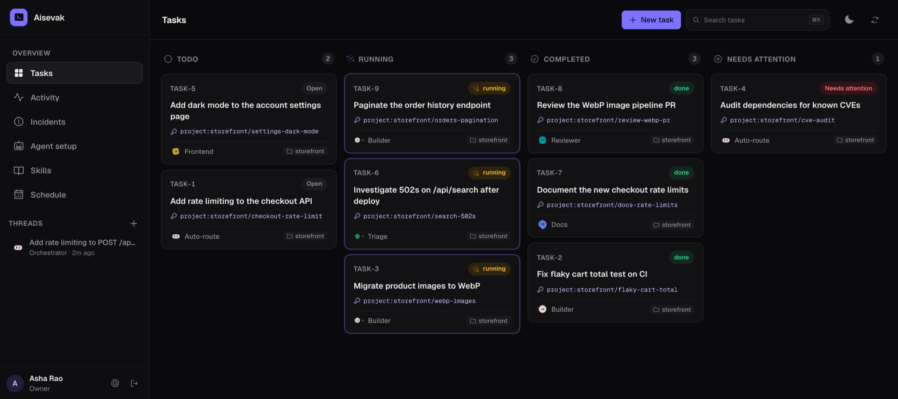
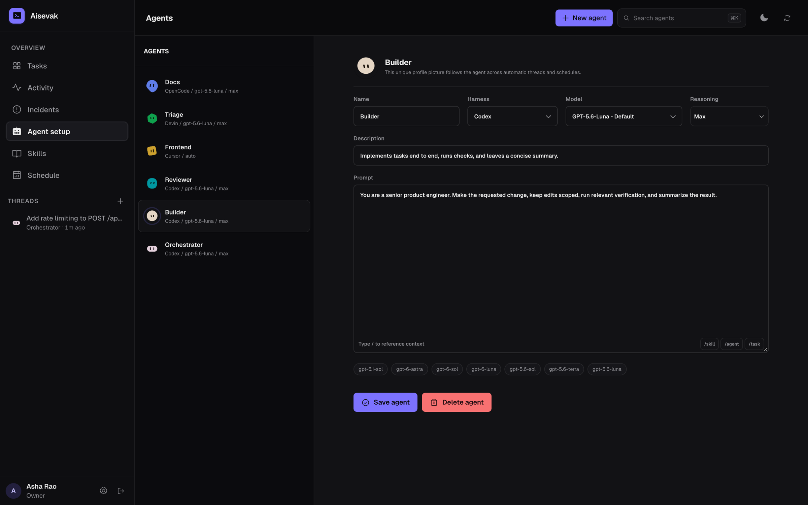

# Aisevak

A self-hosted workspace where coding agents take tasks, work in their own git worktrees, and coordinate with each other through durable threads.

[Quick start](#quick-start) · [How it works](#how-it-works) · [CLI](#the-aisevak-cli) · [Deploy](#deploying-to-a-server) · [Contributing](CONTRIBUTING.md)



## What it does

You give Aisevak a task. An **Orchestrator** agent breaks it down, hands pieces to specialised agents (a Builder, a Reviewer, whatever you define), and reports back when the work is done. Every agent runs a real coding harness on your machine, with real shells, compilers, and test runners.

- **Use the harnesses you already have.** Codex, Claude Code, Cursor, OpenCode, and Devin, each signed in with your own account or API key. Mix them freely: one agent can run on Codex while another runs on Claude Code.
- **Threads that last.** A conversation outlives a single model turn. Each agent keeps its own provider session, so follow-ups, retries, and steering messages pick up where they left off.
- **One worktree per task.** Agents never trip over each other's branches. Each task gets its own git worktree, so many can run in parallel.
- **Agents coordinate through a CLI.** Inside every run, agents use the `aisevak` command to create tasks, message each other, and close out work.
- **Built-in operations.** Schedules for recurring jobs, incidents for things that break, and reports for things worth writing down.

## A look around

**Tasks.** Every piece of work is a task, tracked from open to done. Tasks can be routed by the Orchestrator or assigned straight to an agent.



**Agents.** Define as many agents as you like. Each one has a harness, a model, a reasoning level, and a prompt describing its job.



## Quick start

You need Node.js 20+ (22+ for Claude Code), pnpm 9+, Docker, Git 2.36+, and at least one harness installed (`codex`, `claude-agent-acp` for Claude Code, `cursor-agent`, `opencode`, or `devin`).

```bash
git clone https://github.com/rshabhsinha/aisevak.git
cd aisevak
pnpm install
cp .env.example .env
```

Replace the two placeholder secrets in `.env`. `SECRET_KEY` must be a base64-encoded 32-byte key, because it encrypts saved harness credentials:

```bash
node -e "const c=require('crypto');console.log('SECRET_KEY='+c.randomBytes(32).toString('base64'));console.log('COOKIE_SECRET='+c.randomBytes(32).toString('base64url'))"
```

Start PostgreSQL and apply migrations:

```bash
docker compose up -d postgres
pnpm db:migrate
```

Run the API, runner, and web app together:

```bash
pnpm dev
```

Open [localhost:5173](http://localhost:5173), create the owner account, connect a harness under **Settings**, and add a repository under **Settings → Projects**. Codex signs in with a device code, so it works on remote and headless machines too.

| Service | Address |
| --- | --- |
| Web app | `http://localhost:5173` |
| API | `http://localhost:8787` |

## How it works

```
apps/
  api/      Fastify API, PostgreSQL state, and the coordination layer
  runner/   Picks up queued turns and runs harnesses in isolated worktrees
  web/      React control room
packages/
  cli/      The `aisevak` CLI used by people and agents
  core/     Shared types, migrations, and harness adapters
```

A **task** is the durable unit of work. It has a stable work key and exactly one coordination thread. When the Orchestrator delegates, it creates a keyed **assignment**. Retrying an assignment reuses the same agent thread and provider session wherever possible, so agents don't lose context or duplicate work.

The **runner** polls for queued turns and executes them on the host. Turns on the same agent thread run one at a time; independent turns run in parallel.

## The aisevak CLI

Every agent run gets the CLI on its `PATH`, authenticated with a token scoped to that run. It is how agents read and change shared state. People use the web app for the same things.

```bash
aisevak whoami
aisevak agents list

# Create a task and hand it to an agent
aisevak tasks create --title "Paginate GET /api/orders" \
  --description "Cursor pagination, 50 per page" --agent Builder \
  --work-key orders-pagination

# Message another agent on a thread
aisevak threads send THREAD-8 --to Reviewer --body-stdin < notes.md

# Finish a thread with a summary
aisevak threads complete THREAD-8 --summary-stdin < summary.md

# Open an incident
aisevak incidents declare --title "Queue latency high" \
  --description "p95 above 30s since 14:00" --severity high --markdown-stdin < incident.md
```

Every command prints JSON. Run `aisevak --help` for the full list.

## Configuration

Defaults below are the values the code uses when a variable is unset.

| Variable | Default | What it does |
| --- | --- | --- |
| `RUNNER_MAX_CONCURRENCY` | `4` | Independent turns the runner executes at once (max `32`) |
| `RUNNER_POLL_MS` | `1500` | How often the runner checks for queued work |
| `MANAGED_ROOT` | `/srv/aisevak` | Where worktrees, harness homes, and skills live (`.env.example` uses `.aisevak-managed` for local dev) |
| `AISEVAK_JOB_SAFETY_MODE` | `enforce` | `audit` records unsafe or duplicate work in `job_safety_events` without rejecting it. `.env.example` starts in `audit` for a trial period; switch to `enforce` once the recorded events look right |
| `AISEVAK_AUTO_WORKTREE_CLEANUP` | `1` | Set to `0` to stop the runner removing finished task checkouts |

**Harness sign-in**

- **Codex**: device-code sign-in from the browser, with an OpenAI API key as a fallback.
- **Claude Code**: runs over ACP through `claude-agent-acp` (installed by `scripts/install.sh` on Node.js 22+), using a `claude setup-token` subscription token or an Anthropic API key saved under **Settings → Claude Code**.
- **Cursor**: save a `CURSOR_API_KEY` under **Settings → Cursor**. Subscriptions tied to the macOS keychain never reach agent worktrees.
- **OpenCode**: uses a stored or host `auth.json`.
- **Devin**: runs over ACP using `credentials.toml`, set up by browser sign-in, host import, or API key.

**GitHub.** Connect under **Settings → Connectors** with a classic personal access token (`repo`, `read:org`, `gist`). The runner signs in `gh` and shares the credential helper with agents.

**Skills.** Installed skills live in `${MANAGED_ROOT}/skills` and are mounted into each thread as `$AISEVAK_SKILLS_DIR`. Separately, capabilities control which CLI actions each agent is allowed to take.

**Archiving and cleanup.** Archiving a chat stops its active turns and hides it, but keeps the timeline and provider history; turn on **Show archived chats** to see it again. The runner removes clean, idle checkouts of finished tasks and keeps branches, uncommitted or untracked files, and anything a live process is using.

## Deploying to a server

Before running the installer on Ubuntu 22.04+, install Docker Engine, the Docker Compose plugin, Node.js, and rsync. The installer adds Git and the GitHub CLI if they are missing. Two version requirements to watch:

- **Git 2.36 or newer.** The runner's checkout cleanup uses `git worktree list -z`. Ubuntu 22.04 ships Git 2.34, so install a newer Git first (for example from the `git-core` PPA) or use Ubuntu 24.04.
- **Node.js 22 or newer for Claude Code.** On older Node.js the installer skips the `claude-agent-acp` adapter.

Then run:

```bash
sudo ./scripts/install.sh
```

The installer puts the app in `/opt/aisevak` and workspaces in `/srv/aisevak`, generates secrets, and starts PostgreSQL, the API, and the web app (on port `8080`) with Docker Compose. It also installs the runner as a systemd service (`aisevak-runner.service`). Put a reverse proxy with TLS, such as Caddy or nginx, in front of port `8080`; the installer doesn't set one up.

> [!WARNING]
> Harnesses run with approvals off and full access to the host. Aisevak is built for small, trusted teams. Run it on a dedicated machine or VM.
> Harness credentials (Cursor and Devin keys, the Claude Code token) sit in each harness's environment, so an agent's own shell commands can read them. Run logs redact them.

## Development

```bash
pnpm test        # unit tests
pnpm typecheck   # type-check every package
pnpm build       # build everything
```

See [CONTRIBUTING.md](CONTRIBUTING.md) for conventions.

## License

[MIT](LICENSE)
